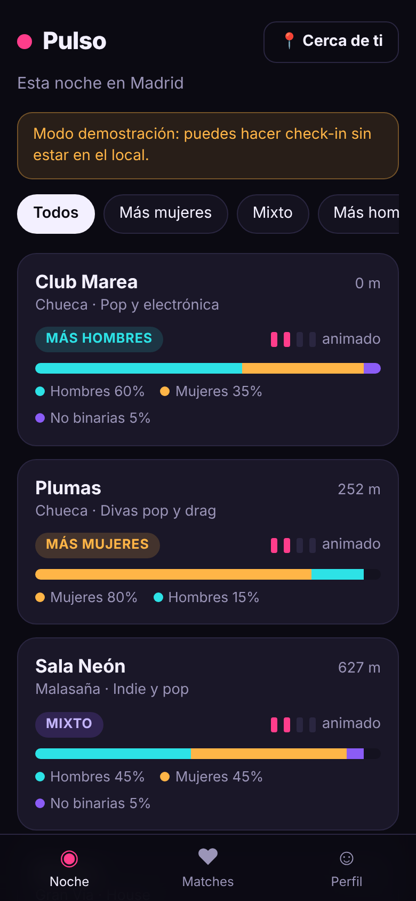
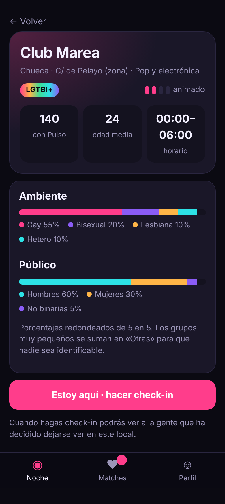
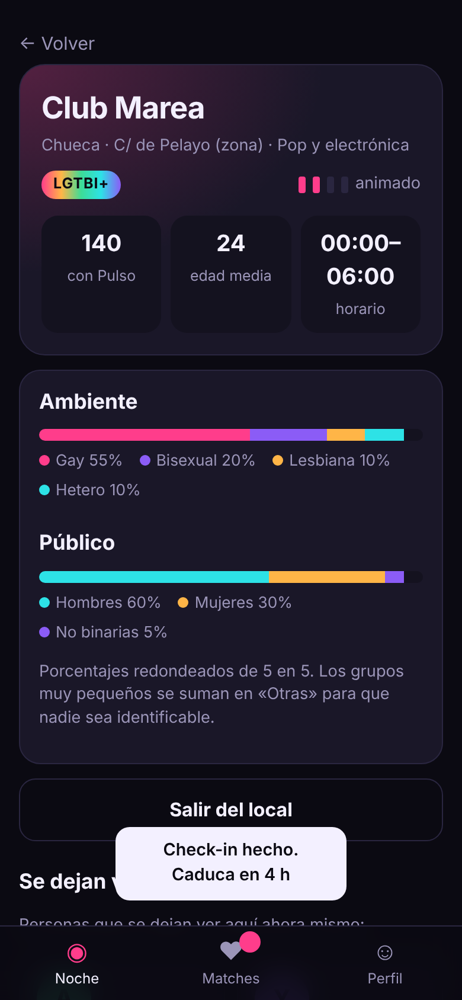
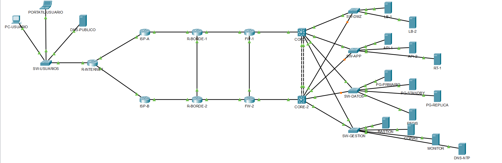

# Pulso · el ambiente de la noche

Pulso es una app móvil (PWA) para saber **qué ambiente hay esta noche en cada discoteca** antes de salir: afluencia, edad media y reparto aproximado del público por género (mujeres, hombres y personas no binarias). Así cada persona puede elegir a dónde ir según el ambiente que busca: más mujeres, mixto o más hombres.

También permite hacer check-in en un local, dejarse ver (si quieres) por la gente que está allí, darse «me gusta», hacer match y chatear en tiempo real.

**Pruébala:** https://pulso-211o.onrender.com (cuenta de prueba **demo@pulso.app / pulso1234**). Está en el plan gratuito de Render: si lleva un rato sin visitas, la primera carga tarda alrededor de un minuto.

Es el proyecto práctico de **dimensionado de servidores y red** de 2.º ASIR: la app es real y la memoria calcula la infraestructura que haría falta para darle servicio en toda España.

<p align="center">
  
  
  
  
</p>

## Privacidad primero

El ambiente se calcula solo con el género: la app no pide ni guarda la orientación sexual ni ningún otro dato especialmente protegido (art. 9 RGPD). Además:

- **El ambiente es agregado y anónimo.** Con menos de 10 personas en un local no se enseña ningún desglose (k-anonimato). Los grupos de menos de 3 se suman en «Otras» y los porcentajes van de 5 en 5.
- **Nadie es visible por defecto.** Quien lo activa solo es visto por la gente que está en el mismo local, y solo se ve su alias, edad, género y bio.
- **No se guardan coordenadas.** La ubicación solo se usa para comprobar que estás en el local al hacer check-in. El check-in caduca a las 4 horas.
- **Solo mayores de 18** y datos mínimos (alias, fecha de nacimiento y género). Desde el perfil se pueden descargar todos los datos o borrar la cuenta.

## Arquitectura

```
móvil (PWA) ──► balanceador ──► API Node.js ×N (sin estado) ──► Redis (caché + tiempo real)
                                     │
                                     ├──► PostgreSQL primario (escrituras)
                                     └──► PostgreSQL réplica (lecturas)
```

| Parte | Tecnología |
|---|---|
| App | PWA en HTML, CSS y JavaScript, sin frameworks; service worker para abrir sin cobertura |
| API | Node.js 22, Express, JWT, bcrypt, helmet, límites de peticiones |
| Tiempo real | Socket.IO con adaptador de Redis (funciona con varios nodos) |
| Datos | PostgreSQL 16 con réplica en streaming y Redis 7 |
| Laboratorio | Docker Compose: nginx + 3 nodos API + Postgres primario/réplica + Redis, en tres redes separadas |

## Puesta en marcha

### Con Docker (recomendado)

```bash
cd infra
docker compose up -d --build
```

Abre http://localhost:8080 y entra con **demo@pulso.app / pulso1234**. En modo demo los datos de ejemplo se cargan solos al arrancar.

Para enseñar la redundancia en clase, con el laboratorio arrancado y desde `infra` en PowerShell:

```powershell
.\demo-caida-nodo.ps1
```

Lanza una prueba de carga contra el balanceador y a mitad apaga de golpe `api-2`. El resultado tiene que salir con **0 errores**.

El laboratorio arranca en **modo demo** (`DEMO_MODE=true`), que permite hacer check-in sin estar físicamente en el local. Para producción hay que ponerlo a `false` y cambiar `JWT_SECRET` y las contraseñas (variables en un fichero `.env` junto al `docker-compose.yml`).

### Demo pública gratuita (Render)

El fichero [`render.yaml`](render.yaml) despliega la app, PostgreSQL y Redis en el plan gratuito de Render con un clic:

[](https://render.com/deploy?repo=https://github.com/samiiamnissar-stack/pulso)

La demo arranca en modo demostración: carga locales y usuarios de ejemplo si la base de datos está vacía y renueva sus check-ins cada 15 minutos para que siempre haya ambiente. En el plan gratuito la web se duerme tras 15 minutos sin visitas (la primera carga tarda alrededor de un minuto) y la base de datos gratuita caduca a los 30 días.

### Sin Docker

Necesitas Node.js 20 o superior, PostgreSQL y Redis en local.

```bash
cd server
npm install
npm run seed
DEMO_MODE=true npm start          # http://localhost:3000
```

Para simular varios nodos sin Docker hay un balanceador sencillo en `server/tools/balancer.js`:

```bash
PORT=3001 NODE_NAME=api-1 npm start
PORT=3002 NODE_NAME=api-2 npm start
PORT=3003 NODE_NAME=api-3 npm start
npm run lb                        # http://localhost:8080, reparte entre los tres
```

## Pruebas

```bash
cd server
npm test                                   # reglas de privacidad (unitarias)
API_URL=http://localhost:8080 npm run smoke   # 17 comprobaciones de extremo a extremo
```

### Prueba de carga

```bash
API_URL=http://localhost:8080 CONNECTIONS=100 DURATION=30 node loadtest/run.js
```

Arranca los nodos con `RATE_LIMIT` alto (por ejemplo `RATE_LIMIT=10000000`), porque si no el límite por IP corta la prueba. Los resultados que aparecen en la memoria están en `loadtest/resultados/`:

| Prueba | pet/s | p99 | Errores |
|---|---|---|---|
| 1 nodo (≈1 vCPU) | 2.792 | 50 ms | 0 |
| 3 nodos detrás del balanceador (misma máquina de 2 vCPU) | 2.348 | 138 ms | 0 |
| 3 nodos y se mata uno a mitad de la prueba | 2.338 | 73 ms | 0 |

## Documentación

- [`docs/Documentación_Dimensionado_Pulso_Samia.docx.pdf`](docs/Documentaci%C3%B3n_Dimensionado_Pulso_Samia.docx.pdf): memoria completa (T1 a T7)
- [`docs/calculos.py`](docs/calculos.py): todos los cálculos de la memoria, para rehacerlos si cambia una hipótesis
- [`docs/img/esquema-red.svg`](docs/img/esquema-red.svg): esquema de red
- [`docs/packet-tracer/`](docs/packet-tracer/): topología de la red en Cisco Packet Tracer (`pulso.pkt`), configuración de cada equipo y tabla de cableado y direcciones
- [`docs/API.md`](docs/API.md): referencia de la API
- [Presentación para la exposición (Canva)](https://canva.link/8b9dw01vp4hucux)

### Red en Packet Tracer

<p align="center"></p>

Es la red de la memoria a escala: dos operadores, routers de borde y cortafuegos duplicados, dos switches de núcleo con la puerta de enlace compartida (HSRP) y cuatro switches de acceso, uno por zona (DMZ, aplicación, datos y gestión), cada uno conectado a los dos núcleos.

### Cifras principales (escenario esperado)

| | |
|---|---|
| Población de 18 a 30 años (INE, 1/1/2025) | 7.026.611 |
| Usuarios activos al mes (30 % de penetración) | 2.086.903 |
| Usuarios activos al día | 730.416 |
| Conectados a la vez en hora punta (23:00) | 43.825 |
| Peticiones por segundo en el pico | 13.147 |
| Nodos API / tiempo real | 14 (13+1) / 6 (5+1) |
| Enlaces | 2 operadores × 10 Gbps |

## Estructura

```
server/     API y app (public/)
infra/      docker-compose, nginx y scripts de replicación de PostgreSQL
loadtest/   prueba de carga y resultados
docs/       memoria, cálculos, esquema de red, capturas y topología de Packet Tracer
```

---

Los locales y los usuarios de prueba son inventados.

Hecho por **Samia El Yahyaoui Mnissar** · 2.º ASIR
